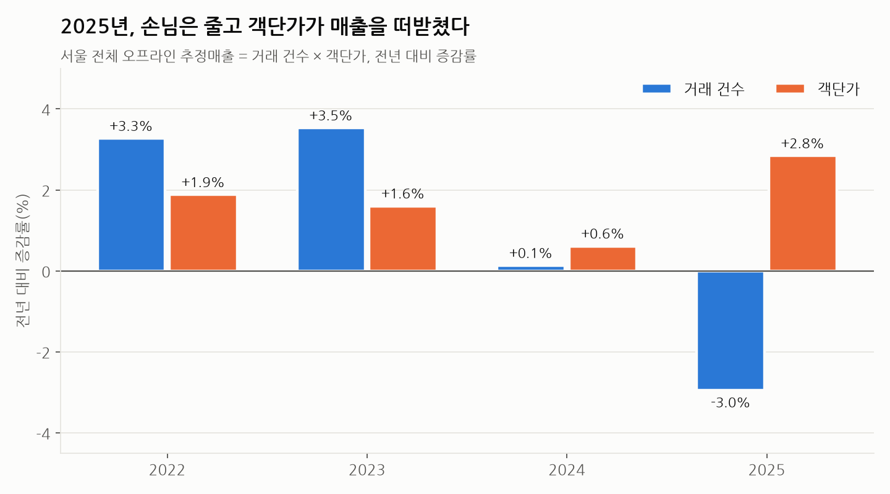
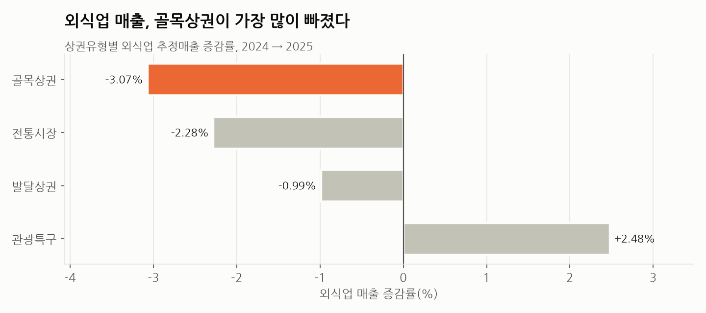
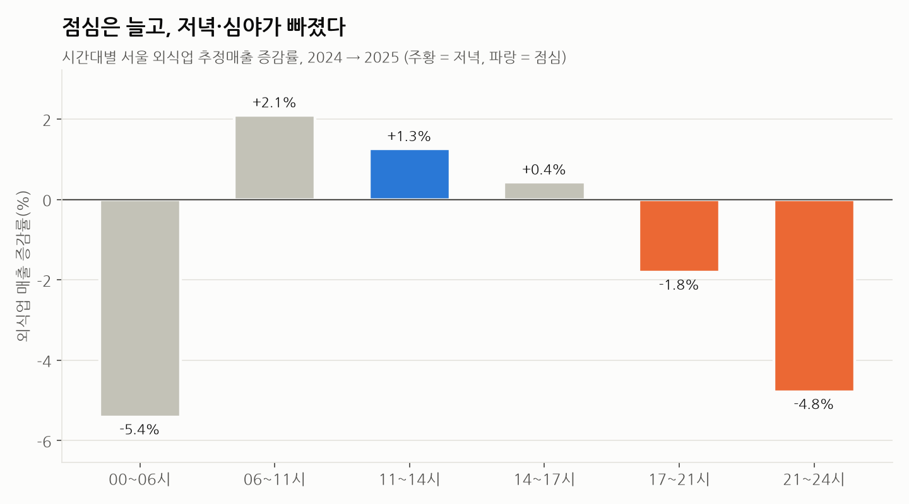
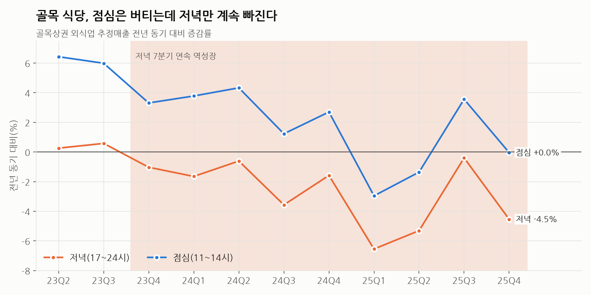
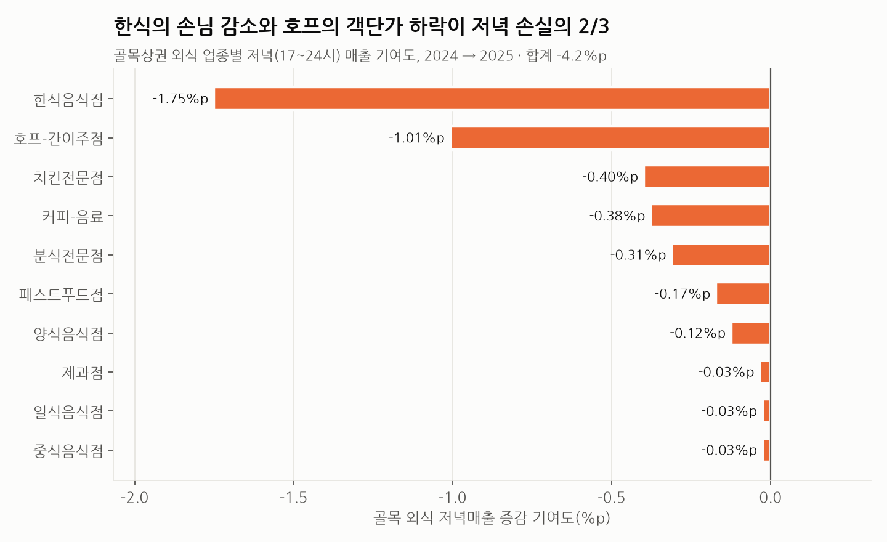
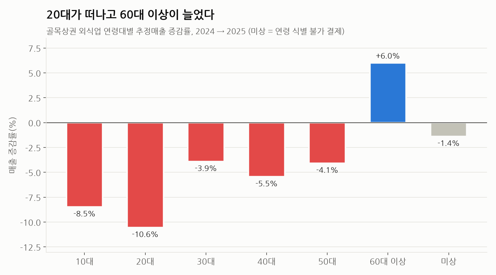
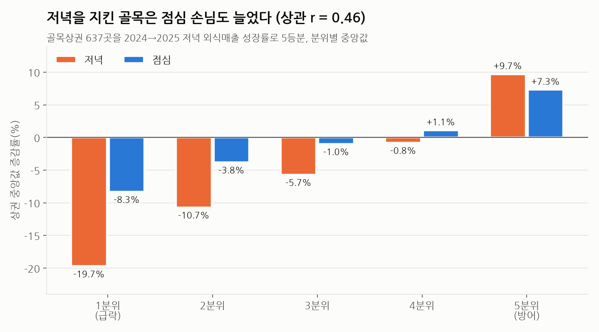
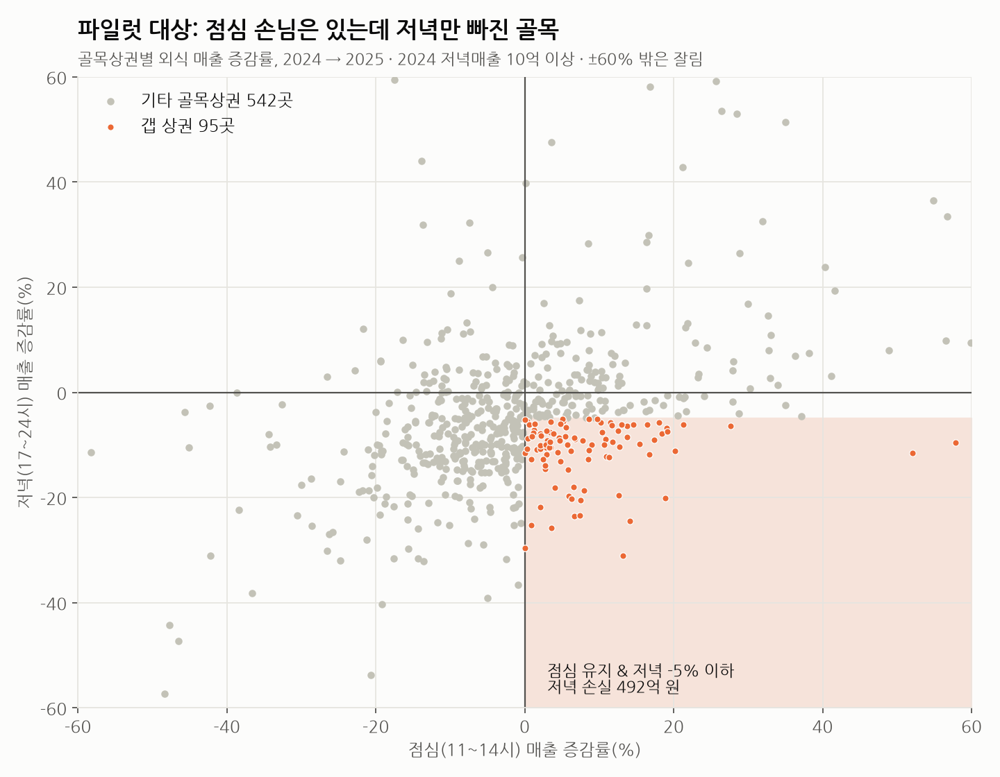

# 서울 오프라인 매출 MECE 분해 (2021~2025)

서울시 상권분석서비스(추정매출-상권) 5개년 데이터를 로직트리로 쪼개서
"2025년 서울 오프라인 매출은 무엇이, 어디서, 언제 변했는가"를 분석한다.

## 데이터
- 출처: 서울 열린데이터광장, 서울시 상권분석서비스(추정매출-상권) 2021~2025년 (분기별)
- 규모: 연 약 8.6~8.9만 행 (상권 약 1,580개 × 서비스업종 62개 × 4분기)
- 원본은 CP949 인코딩 → UTF-8로 변환해 `sales_2021.csv` ~ `sales_2025.csv`로 저장
- 고시원(CS200036)은 2024년부터 업종에서 빠져 연도 비교를 위해 전 연도에서 제외

## 로직트리
```
총매출 증감
├─ L1  매출 = 거래건수 × 객단가                → 02_L1_total_decomposition.sql
├─ L2  외식업 / 서비스업 / 소매업 → 62개 업종  → 03_L2_category_contribution.sql
├─ L3  상권유형 × 시간대 × 주중·주말           → 04_L3_where_and_when.sql
└─ L4  골목상권 × 외식업 × 저녁(17~24시)        → 05_L4_alley_dinner.sql
```
L4 결과를 바탕으로 한 실행 기획: [기획안_골목식당_저녁매출_방어.md](기획안_골목식당_저녁매출_방어.md)

## 실행
```bash
python3 -m venv .venv && .venv/bin/pip install duckdb && source .venv/bin/activate
# ../데이터/*.zip(CP949) → sales_YYYY.csv(UTF-8)
python -c "
import zipfile,glob,re
for z in glob.glob('../데이터/*.zip'):
    zf=zipfile.ZipFile(z); open('sales_%s.csv'%re.search(r'(20\d\d)년',z)[1],'w',encoding='utf-8').write(zf.read(zf.namelist()[0]).decode('cp949'))"
# CSV가 있는 폴더에서
python -c "import duckdb; con=duckdb.connect('seoul.duckdb'); con.execute(open('sql/00_load.sql').read())"
python -c "import duckdb; con=duckdb.connect('seoul.duckdb'); print(con.sql(open('sql/02_L1_total_decomposition.sql').read()))"
# 05는 결과 표가 여러 개라 블록별로 출력
python -c "
import duckdb; con=duckdb.connect('seoul.duckdb')
[con.sql(s).show(max_rows=50, max_width=250) for s in open('sql/05_L4_alley_dinner.sql').read().split(';') if 'SELECT' in s]"
```

## 파일
| 파일 | 내용 |
|---|---|
| sql/00_load.sql | 5개년 CSV 적재, 분석용 컬럼명 정리 |
| sql/01_integrity_check.sql | MECE 검증: 하위 축 합계 = 총매출인가 |
| sql/02_L1_total_decomposition.sql | 건수 효과 vs 객단가 효과 (로그 분해) |
| sql/03_L2_category_contribution.sql | 업종별 성장 기여도 (비중 × 성장률) |
| sql/04_L3_where_and_when.sql | 외식업 상권유형·시간대·요일별 기여도 |
| sql/05_L4_alley_dinner.sql | 골목 외식 저녁: 분기 추이·업종·상권 5분위·연령 |
| 기획안_골목식당_저녁매출_방어.md | L4 결과 기반 파일럿 기획안 |
| charts.py | sql/02·04·05를 실행해 `charts/*.png` 8장 생성 (`pip install matplotlib`, NanumGothic 폰트 필요) |

## 그래프
| | |
|---|---|
|  |  |
|  |  |
|  |  |
|  |  |

## 한계
- 카드 결제 기반 **추정** 매출이며 개별 매장 단위가 아님 → 리텐션·코호트 분석 불가, 시장 단위 분석으로 한정
- 성별·연령 축은 총매출의 약 88.7%만 설명(식별 불가 결제) → 이 축을 쓸 때는 '미상' 항목을 따로 둠
- 청과상(+17.8%)·수산물판매(-11.6%)처럼 인접 업종이 반대로 크게 움직인 경우 업종 분류·추정 방식 변화 가능성이 있어 결론 근거에서 제외
